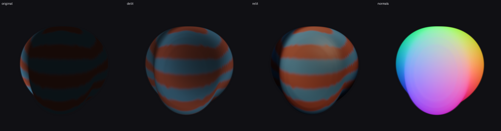
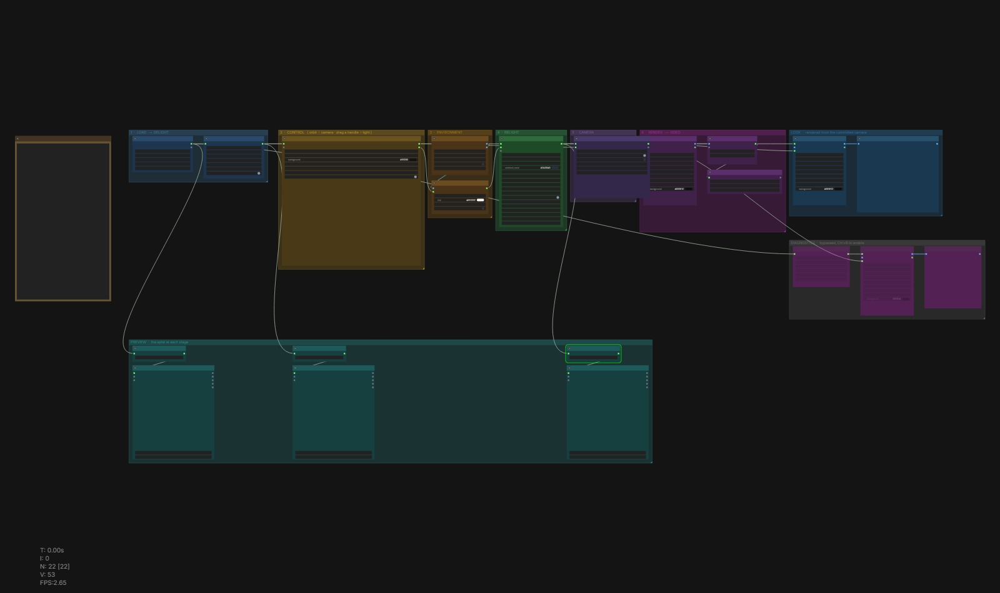
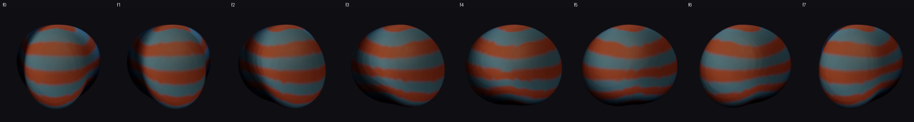
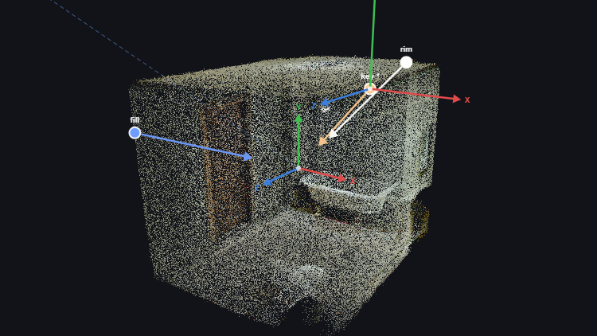
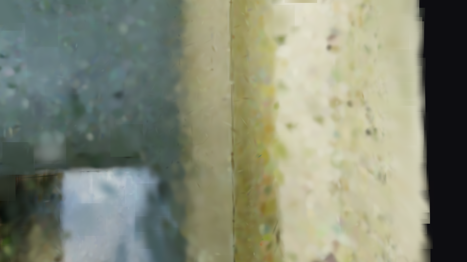
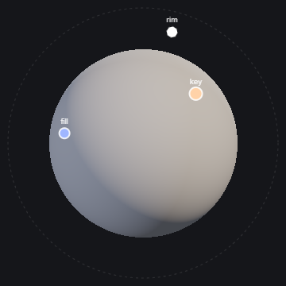
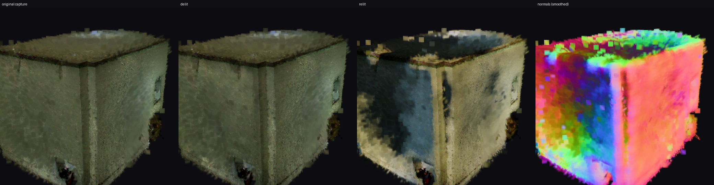
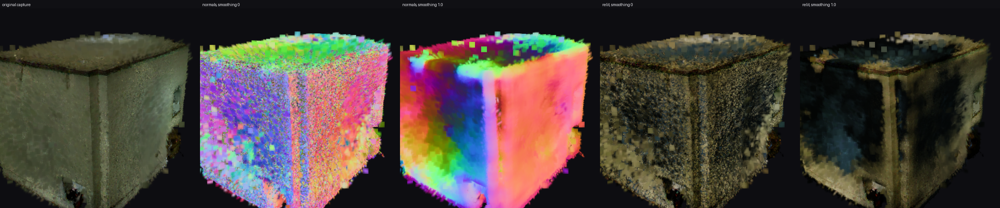
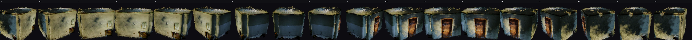
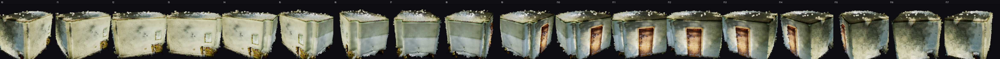

# ComfyUI-SplatRelight

Relight animated 3D gaussian splats inside ComfyUI.

A gaussian splat capture bakes the lighting of the room it was shot in directly
into the primitives. This node pack estimates that baked lighting, removes it,
and re-shades every gaussian with a light rig you control — key, fill, rim,
HDRI environment — with self-shadowing and ambient occlusion, across an animated
sequence.

Built on ComfyUI's native `SPLAT` type (0.23.0+). No external dependencies.



*Left to right: the original capture with lighting baked in, the delit albedo
estimate, the relit result, and the surfel normals used to shade it.*

---

## Why relight the gaussians instead of the render

The obvious approach is deferred shading: render the splat, take the normal and
depth buffers, and light in 2D. `RenderSplat` even gives you those buffers.

This pack doesn't do that, deliberately. Screen-space relighting re-derives the
lighting for every camera and every frame, so a turntable swims and shadows
detach from the geometry. Instead, each gaussian's spherical-harmonic DC term is
rewritten from a physically-based shade of its own surface normal. The result is
one lit asset that is consistent from every angle, animates coherently, and can
be exported straight back out to `.ply` for any other splat viewer.

### Where the normals come from

3DGS has no normals. But a well-converged reconstruction produces strongly
oblate gaussians lying tangent to the surface, so the **shortest axis of each
gaussian's covariance is a surface normal**. ComfyUI's own rasteriser uses the
same estimator for its clay shading.

Two things then have to be fixed before those normals are usable, and on real
data both matter more than the shading model does.

**They are noisy.** A reconstruction is optimised to reproduce images, not
geometry, so plenty of gaussians stay round enough that their shortest axis is
close to arbitrary. Neighbouring gaussians on the same wall *do* share a
surface, though, so `normal_smoothing` averages each normal over a small spatial
neighbourhood — weighted by flatness and opacity, so confident gaussians drive
the plane. On a synthetic wall with heavily corrupted normals this lifts
agreement with ground truth from 0.67 to 0.995 mean cosine, while a sphere keeps
its curvature at 1.000.

**They have no sign.** The axis is a line, not a direction, and `orient_normals`
offers two strategies:

| mode | how | when |
|---|---|---|
| `visibility` | ray-march the occupancy grid along `+n` and `−n`, keep whichever escapes more easily | **default** — correct on concavities and interiors |
| `outward` | flip away from the scene centroid | fast; fine for convex, object-centric captures |

A purely local density probe — "which side has less stuff right here" — sounds
reasonable and *does not work*: a splat reconstruction is a hollow shell, so
there is empty space on both sides of the surface. Integrating along a long ray
fixes it, because the inward ray eventually hits the far wall. On a test shell it
takes orientation accuracy from 83% to 100%.

### Delighting

Under the standard prior that albedo is uncorrelated with surface orientation,
whatever part of the observed colour is explained by normal direction is
illumination. So we fit a spherical-harmonic shading field to luminance and
divide it out.

The fit is **order-2 (9 coefficients)**, which matters more than it sounds. Real
baked lighting is a sum of *clamped* cosine lobes; an order-1 fit cannot
represent the clamp, undershoots into negatives on the unlit side, and then
explodes when divided out. Order-2 SH captures ~99% of any diffuse irradiance
field (Ramamoorthi & Hanrahan 2001), so the residual is genuinely albedo.

#### What this cannot do, measured

The fit is a function of the **normal alone**, `S(n)`. Position never enters it.
So two patches of floor — one in the open, one under a bath — share a normal,
receive an identical correction, and the cast shadow between them survives
untouched. That is arithmetic, not a tuning failure.

On a real indoor capture (1.92M gaussians, diffusely lit) this bites hard:

| measurement | result |
| --- | --- |
| fitted field, whole sphere | **1.12×** between brightest and darkest orientation |
| same, best normals + smoothing | **1.58×** |
| ambient occlusion vs observed darkness | r = −0.08 … +0.08 |
| key-light visibility vs observed darkness | r = −0.04 … −0.14 |
| **observed lit/shadow contrast on the floor** | **4.55×** |

Delighting moved the scene's contrast by 0.2%. Two spatial priors were tried and
both are uncorrelated with the actual darkness, so neither would remove a shadow —
they would only stamp an unrelated pattern onto the albedo. Separating shading
from albedo in a single capture is ill-posed, and a diffusely lit room is the
worst case: there is no directional signal to attribute anything to.

`shadow_lift` is the honest fallback. It does not model anything — it compresses
luminance contrast directly, turning a ratio `r` into `r^(1-lift)`. It cannot
distinguish a shadow from dark paint and lightens both, which is exactly why it
is a separate control that defaults to off.

---

## Install

```bash
git clone https://github.com/paulringue/ComfyUI-SplatRelight custom_nodes/ComfyUI-SplatRelight
```

Restart ComfyUI. Requires **ComfyUI 0.23.0 or newer** for the native `SPLAT`
type. Nothing to pip install — it runs on the torch you already have, on CPU or
GPU.

## Quick start

1. Put your per-frame splat files in `ComfyUI/input/splat_sequence/`
   (`frame_000.ply`, `frame_001.ply`, …).
2. Load `workflows/relight_animated_splat.json`.
3. Queue.

No animated splat handy? A single `.ply` works fine — you get one frame and can
still relight it.



*Numbered, colour-coded groups reading left to right: load and delight, build the
rig, relight, render. The three splat viewers along the bottom are also the
controls — orbit **B** to aim the key light, orbit **C** to set the render
camera, with Frame Splat Camera guarding the result. Diagnostics stay bypassed
until you need them.*



*The eight frames of `SplatRelight_00001_.mp4`, straight out of the shipped
workflow on ComfyUI 0.24.1: geometry deforming, warm key from upper right, and
the cool rim light travelling across the sequence via `orbit_speed`.*

---

## Nodes

### Load Splat Sequence
A folder of `.ply` / `.splat` / `.ksplat` / `.spz` files becomes one animated
splat. Files are sorted by name and each becomes a frame in the splat batch,
which `RenderSplat` renders as an image sequence. Frames with **different
gaussian counts are handled** — they are padded and tracked with ComfyUI's
`counts` field, which matters because most 4D pipelines densify per frame.

### Delight Splat
Estimates and removes baked illumination. `amount` blends between the original
bake and full albedo; `shadow_floor` bounds the divisor so deep shadows don't
come back as noise. `shadow_lift` (default 0, off) is the fallback for baked
shadows the physical fit provably cannot reach — see
[what this cannot do](#what-this-cannot-do-measured).

### Splat Light
One light per node, chained into a rig. Directional, point, or spot.

`yaw`/`pitch` deliberately use **the same convention as Create Camera Info**, so
a light at yaw 35 / pitch 30 sits exactly where a camera at yaw 35 / pitch 30
would. `orbit_speed` rotates the light per frame, so lighting animates across a
sequence independently of the geometry.

### Load HDRI (EXR / HDR)
Reads OpenEXR `.exr` and Radiance `.hdr` panoramas as linear HDR images.

ComfyUI's `Load Image` goes through Pillow, which reads neither format — and for
image-based lighting that is not a cosmetic gap. An HDRI's useful information
lives *above* 1.0: the sun in the test panorama below peaks near 600, and
converting to 8-bit PNG clips precisely the values that do the lighting.

The reader is dependency-free:

| format | support |
|---|---|
| `.hdr` / `.pic` | Radiance RGBE, new- and old-style RLE — complete |
| `.exr` | scanline, `NONE` / `RLE` / `ZIP` / `ZIPS`, HALF or FLOAT channels |

That covers the large majority of HDRIs in circulation. `PIZ`, `PXR24`, `B44`
and `DWAA` need a full codec, so those defer to `OpenEXR`, `opencv-python` or
`imageio` if one happens to be installed, and otherwise raise an error naming the
compression rather than failing obscurely.

Outputs are `image` (linear, values above 1.0 preserved — feed this to the
environment light) and `preview` (tone mapped, safe for a `Preview Image` node).

### Splat Environment Light
Image-based lighting from an equirectangular panorama, projected onto order-2
SH. Because it's just an image input, you can generate the HDRI upstream in
ComfyUI and light the splat with it.

Feeding it `Load HDRI` means turning **`input_is_srgb` off** — that output is
already linear, and leaving the flag on would darken the environment twice.

### Relight Splat
The shading pass: Lambert diffuse plus Cook-Torrance GGX specular, with
self-shadowing and AO ray-marched through an occupancy grid rebuilt per frame —
so deforming geometry casts correctly deforming shadows.

`view_vector` deserves a note. ComfyUI's rasteriser reads **only the SH DC term**,
so view-dependent specular can't be stored as higher SH bands and must be baked
for one view direction. `normal` (default) is view-independent and stays stable
on a turntable; `camera` is physically correct for a single fixed viewpoint and
needs `camera_info`.

### Live previews

The shipped workflows carry three **Preview Splat** viewers along the bottom —
after loading, after delighting, and after relighting — so you can orbit the
actual splat at each stage instead of inferring what happened from the final
render. Each is a `Create 3D File (from Splat)` set to `spz` feeding ComfyUI's
native `PreviewGaussianSplat`.

Two things worth knowing:

- `Create 3D File (from Splat)` **handles one batch item only**, so on an
  animated sequence the viewers show *frame 0*. The video output still covers
  every frame.
- `spz` is gzip-compressed and roughly 10× smaller than `.ply` — a 1.92M-gaussian
  capture comes out around 27 MB per viewer. Bypass the three pairs with
  **Ctrl+B** when iterating on a heavy scene.

### Splat Viewport
An interactive 3D view of the splat where you set the camera and move the lights.



Left-drag orbits, right-drag pans, scroll zooms, and dragging a coloured handle
moves that light — the handle is a real point in 3D on a sphere around the
subject, aimed by intersecting your cursor's ray with that sphere. Each light
draws an **arrow toward the subject**, so you can read where it is and which way
it throws at a glance. Double-click a handle to switch its light off.

**Set Camera / Recall.** Orbiting only moves the preview; the graph renders from
the camera you *commit*. That means you can look around, or reposition a light
from another angle, without disturbing a framing you already chose. The button
reads `Set Camera •` in blue whenever the live view has drifted, flashes
`Camera Set ✓` when you commit, and a small `render cam` marker shows where the
committed camera sits while you are away from it. **Recall** snaps back to it.

The viewport is **16:9 to match an HD render**. That is not cosmetic: the
viewport exists to decide framing, so its aspect has to equal the render's or
what you frame is not what you get. The shipped workflows render 1280×720 to
match.

Written on WebGL2 from first principles — no third-party viewer and nothing
bundled. Points are drawn as depth-tested round sprites rather than
alpha-blended splats: for a viewport whose job is aiming lights that reads just
as well, costs one draw call, and sidesteps per-frame depth sorting entirely.
The final image always comes from ComfyUI's real rasteriser, so the preview is a
control surface, not a competing renderer.

`max_points` decimates what gets sent to the browser (180k by default, ~3 MB);
relighting and rendering always use every gaussian.

### Seeing the actual render

The viewport draws points, not splats — it is a control surface, and keeping it
cheap is what lets it stay responsive while you drag. To see the real thing, the
workflows carry a **LOOK** branch: `Render Splat` at 960×540, one frame, fed by
the *same* guarded camera the final render uses, into a `Preview Image`.



So the loop is: aim in the viewport, hit Run, look at the rendered frame. It uses
ComfyUI's real rasteriser with your lighting applied, at a size that returns
quickly — the 1280×720 turntable in group 5 stays the deliverable.

**It reads the *delit* splat, not the relit one.** That is deliberate: the
viewport's rig output drives the relight, so taking its input from downstream of
that would make the graph cyclic. The relit result is what preview **C** is for.

### Splat Light Gizmo
A three-point rig you aim by dragging rather than by typing angles.



The node draws a lighting ball: drag a handle to point that light, drag it
outside the ring to swing it round behind the subject, double-click to switch it
off. The sphere is shaded live by the colours and intensities on the node, so you
can judge the rig before committing to a render.

Two details worth knowing. The back hemisphere is mapped onto the annulus outside
the disc — continuous at the rim, reaching directly-behind at the outer edge — so
a rim light's handle stays visible and grabbable instead of disappearing under
the silhouette. And it is plain canvas 2D on purpose: a three.js viewport would
mean bundling ~600 KB into a pack that otherwise has no dependencies, and for
aiming lights a shaded sphere tells you what you need at 60fps.

The JSON behind it stays editable on the node, so the graph still works headless
or if the frontend extension fails to load.

### Splat Light from Camera
Places a light where a camera is and aims it at what that camera looks at. Wire a
**Preview Splat viewer's `camera_info` output** into it and the viewport becomes
a lighting gizmo: orbit until the view looks like where you want the light, and
that *is* the light. Falls back to plain yaw/pitch until the viewport has been
touched, so a fresh graph still runs.

The viewer's `camera_info` **output** is the live one. Connecting anything to a
viewer's camera_info *input* overrides its viewport and freezes it — which is why
nothing is connected there in the shipped workflows.

### Frame Splat Camera
A guard between a viewer's camera and `Render Splat`, and not optional in
practice. Two things bite:

- ComfyUI's rasteriser returns an **empty frame when the camera is inside the
  geometry**, and an interactive viewer will happily auto-frame *inside* a room
  capture. Straight from viewport to renderer, most frames came out blank.
- A camera_info **without a quaternion** silently breaks turntables: ComfyUI's
  orbit helper defaults a missing one to *identity* and then writes it into the
  camera it returns, so the renderer takes the quaternion path with a rotation
  unrelated to the look-at. 17 of 18 frames rendered empty until this node
  emitted a real look-at quaternion.

With a camera connected it is a **safety net, not a framing tool**: it keeps your
distance and aim and only pushes out far enough to clear the geometry
(`respect_camera`, on by default). Left to frame things itself — no camera
connected — it uses the fit distance instead, since there is no composition to
protect.

Clearance is measured against the radius that *encloses* the splat, not the
typical one. A room 4 deep and 3 wide reports a quantile radius of ~1.85 while
its far wall is at 2.0, and clearing only 1.85 leaves the camera inside, where
the rasteriser renders nothing.

The hard limit remains: **you cannot render from inside the geometry.** Zoom
right into a detail and the node will pull you back to just outside the shell —
close, but not inside it. **Crop Splat** is the way around that.

### Crop Splat
Keeps only the gaussians inside a box or sphere.

The obvious use is speed, but the real one is getting close. Because the
rasteriser refuses to render from inside geometry, a room capture has a floor on
how near you can get — on the bathroom, no closer than 2.22 units from the
centre. Crop to the fixture you care about and the shell you must stay outside
becomes *that*, not the room:

| | shell radius | closest usable camera |
|---|---|---|
| whole room | 1.99 | 2.22 |
| cropped to a 1.6 m box | 0.77 | **1.85, framing only the crop** |

**You place and size it in the viewport, not by typing numbers.** Turn on
`show_crop` in Splat Viewport and the region is drawn in 3D — a wireframe box, or
three great circles for a sphere. Then:

| grab | does |
|---|---|
| the yellow dot at its centre | slides the region freely in the view plane |
| an **X / Y / Z arrow** | moves it along that axis only |
| a coloured **square handle** on a face | resizes *that axis alone*, with the live dimension shown |

Wire the viewport's `crop` output into Crop Splat and enable the node. Hit
targets are held constant in screen pixels, so the handles stay grabbable at any
graph zoom.

That forced one structural change worth knowing about: the crop sits **after**
the viewport, not before it. With the crop upstream the viewport would only ever
show what had already been cut, so you would be positioning the box against the
very thing it removes. The graph is `Load → Delight → { Viewport, Crop } →
Relight`, which keeps the viewport on the whole splat while the crop feeds the
render.

`invert` keeps the *outside* instead, which is the quick way to drop a floor or a
near wall that blocks the shot. A camera can still be connected to centre the
crop on what you framed, for when you would rather not drag.

It ships bypassed in both workflows — **Ctrl+B** to enable.

### Splat Relight Debug
Bakes `normals`, `ambient_occlusion`, `estimated_shading`, `albedo`, or
`flatness` into the splat colour so you can inspect it with `RenderSplat`.

**Check this first when a relight looks wrong.** In `normals` mode a good
capture shows a smooth colour gradient across the surface. A noisy patchwork
means the gaussians are too round for their normals to be trusted — check
`flatness`, which is what the estimator's confidence is built on.

---

## On a real capture

Everything above is easy to believe on synthetic data where you control the
ground truth. Here it is on a real one: a 1.92M-gaussian interior scan of a
derelict bathroom, SH degree 0.



*Original capture, delit, relit, and the smoothed normals. The relight puts a
warm key over the camera's shoulder and lets the left wall fall into cool
shadow — lighting that simply is not present in the source.*

The capture is a blunt test of the normal estimator, and it failed it at first:

| | synthetic sphere | real capture |
|---|---|---|
| mean flatness | ~0.89 | **0.472** |
| below 0.5 | ~0% | **55.6%** |
| above 0.8 | ~100% | **4.9%** |

More than half the gaussians are too round for their shortest axis to mean much,
and the first relight came out as coloured speckle. `normal_smoothing` is the
fix, and the difference is not subtle:



*Normals with smoothing off, then on. Rainbow noise becomes one coherent colour
per wall — blue left, red right, green ceiling — which is what a correctly
estimated normal field looks like.*

Two honest findings from this scan:

- **Delighting barely changed it.** The room was lit fairly uniformly, so there
  is little orientation-correlated shading to remove and the albedo estimate is
  nearly the original. The step is close to a no-op here, which is the right
  behaviour — but it means delighting earns its keep on directionally lit
  captures, not every one.
- **A relit interior gets darker, and that is correct.** With coherent normals a
  whole wall faces away from the key and goes uniformly dark, where noisy
  normals gave a brighter random average. Budget more ambient than you expect.



*18-frame orbit of the relit capture. The lighting stays welded to the geometry
as the camera moves — the point of relighting the primitives rather than the
render.*



*The same capture lit by an `.exr` sky panorama through Load HDRI and Splat
Environment Light — cool skylight from above, warm sun from one side, in place of
the two-light rig.*

### One thing to know about `RenderSplat`

ComfyUI's rasteriser returns an **empty frame when the camera is inside the
geometry** — coverage drops to exactly zero once the camera crosses the shell.
It reproduces on a synthetic hollow sphere too, independent of gaussian size, so
it is not specific to any one file. For interior scans, frame from outside. It
is the reason the example above orbits the room rather than standing in it.

---

## A coordinate-frame trap

ComfyUI has two frames in play. `Load3D` / `camera_info` / `CreateCameraInfo`
are three.js: right-handed, **Y-up**. The gaussian data itself is 3DGS:
**Y-down, Z-forward**. They differ by a 180° rotation about X.

Lights are authored in viewer space and converted on the way in, which is why
light yaw matches camera yaw. If you extend this pack, that conversion
(`relight_core.viewer_to_splat`) is the thing to get right — it is invisible in
every numeric check, because a light pointed at the back of the subject produces
perfectly finite, perfectly in-range, perfectly wrong output.

---

## Limitations

Worth being straight about:

- **Delighting is an estimate, not inverse rendering.** It has no ground-truth
  material decomposition. Albedo that genuinely correlates with surface
  orientation (horizontal stripes on a sphere) gets partially absorbed into the
  lighting estimate. Back `amount` off when that happens.
- **Normals depend on capture quality.** Undertrained or low-quality
  reconstructions have rounder gaussians whose shortest axis means little. On
  the real capture above, 55% of gaussians fell below 0.5 flatness.
  `normal_smoothing` recovers most of it, at the cost of genuine fine detail —
  it cannot invent a surface that was never reconstructed. Use the `flatness`
  and `normals` debug channels to judge which side of that trade you are on.
- **Shadows and AO march a voxel grid**, not the gaussians themselves. Soft and
  cheap rather than sharp and exact; `grid_resolution` trades one for the other.
- **No global illumination.** Direct lighting plus an ambient/environment term.
  No bounce light, no caustics, no transmission.
- **Specular is baked for one view direction** — see `view_vector` above.

---

## Tests

```bash
python tests/test_relight_core.py
python tests/test_hdri_io.py
```

91 assertions in total. The HDRI suite writes `.exr` and `.hdr` files with
encoders derived straight from the format specs, independently of the readers —
so a matching round-trip is real evidence both directions are right, rather than
two copies of the same misreading.

The other 71 cover the physics rather than just the plumbing: Lambert
returning albedo at intensity π, point lights falling off as exactly 1/d²,
metals losing their diffuse term, spot cones cutting off, uniform environments
producing direction-independent irradiance, delighting recovering a known
albedo, and normals matching ground truth on a synthetic shell.

`relight_core.py` has no ComfyUI imports, so the tests need only torch.

## License

MIT
